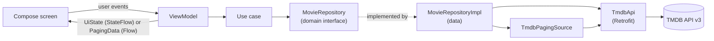

# Cinevo

Cinevo is an Android app for browsing movies from [The Movie Database (TMDB)](https://www.themoviedb.org/). Pick a
genre, scroll an endless list of its movies, then open a movie to see its details, its YouTube trailer and what
users wrote about it.

Built with Kotlin, Jetpack Compose and Material 3, following Clean Architecture with MVVM.

## Contents

- [Features](#features)
- [Screenshots](#screenshots)
- [Tech stack](#tech-stack)
- [Architecture](#architecture)
- [Error handling](#error-handling)
- [Setup](#setup)
- [Testing](#testing)
- [Code quality](#code-quality)

## Features

How each of the assessment's user stories is covered:

| # | User story | Where |
|---|------------|-------|
| 1 | See the list of official movie genres | **Home**: a grid of genre tiles from `genre/movie/list`. Each genre keeps the same color gradient across launches. |
| 2 | See the movies of a genre (discover by genre) | **Movie list**: opened from a genre tile. Loads `discover/movie?with_genres=…`, sorted by popularity, as a poster grid with ratings. |
| 3 | See a movie's primary information | **Movie detail**: backdrop, poster, title, release year, runtime, rating and vote count, genres, tagline and overview. |
| 4 | Read the user reviews of a movie | **Movie detail** previews the first reviews; **Reviews** lists all of them. Markdown and HTML in reviews are cleaned up, and long reviews expand with *Read more*. |
| 5 | Watch the movie's YouTube trailer | **Movie detail**: an embedded YouTube player, preferring the official trailer, then any trailer, then a teaser. *Open in YouTube* hands off to the YouTube app or browser. |
| 6 | Endless scrolling on movies and reviews | **Movie list** and **Reviews** load page by page with Paging 3 as you scroll, with pull-to-refresh and a retry row when a page fails. |
| 7 | Positive and negative cases are handled | Every screen has loading, content, empty and error states with retry. See [Error handling](#error-handling) and [Testing](#testing). |

Also included:

- **Trending this week** row on the home screen (`trending/movie/week`).
- Light and dark themes that follow the system setting, with edge-to-edge layout.
- Accessibility: content descriptions on posters, ratings and icon buttons, headings for screen-reader
  navigation, error messages announced as they appear, and 48dp touch targets.
- State survives rotation and process death: navigation arguments come from `SavedStateHandle`, paged data is
  cached in the ViewModel, and scroll positions and expanded reviews are saved.

## Screenshots

| | Home | Movie list | Movie detail | Reviews | Error state |
|---|---|---|---|---|---|
| **Light** |  |  |  |  |  |
| **Dark** |  |  |  |  |  |

## Tech stack

| Library | Why |
|---------|-----|
| **Kotlin** + **Coroutines/Flow** | Structured concurrency for network calls, and `StateFlow` as the single source of UI state. |
| **Jetpack Compose** + **Material 3** | Declarative UI that renders straight from state, with a themeable design system and built-in dark mode. |
| **Navigation Compose** (type-safe routes) | Routes are `@Serializable` classes, so arguments are checked at compile time and restored from `SavedStateHandle`. |
| **Hilt** (KSP) | Android's standard DI: compile-time checked graph and constructor injection into ViewModels. |
| **Retrofit** + **OkHttp** | Declarative, suspend-friendly HTTP client. OkHttp interceptors add the auth header and, in debug builds only, logging. |
| **kotlinx.serialization** | Kotlin-first JSON parsing that generates code at compile time instead of using reflection, so it works with R8 and understands Kotlin nullability and default values. |
| **Paging 3** | Endless scrolling with load states for refresh and append, retry, and a page cache that survives configuration changes. |
| **Coil 3** | Compose-native image loading built on coroutines, sharing the OkHttp stack. |
| **android-youtube-player** | Embeds YouTube's IFrame player in a view with lifecycle support; it needs neither a YouTube API key nor the YouTube app. |
| **JUnit 4**, **MockK**, **Turbine**, **kotlinx-coroutines-test** | Unit tests for coroutine and Flow code with a controllable clock. |
| **MockWebServer**, **paging-testing**, **Robolectric** | The real Retrofit stack against canned HTTP responses, `PagingData` snapshots, and `SavedStateHandle` route parsing on the JVM. |
| **Compose UI Test** | Instrumented tests of each screen's states and interactions. |
| **Detekt** (+ Compose rules), **Spotless** (ktlint) | Static analysis and consistent formatting, enforced from the command line. |

All versions live in [`gradle/libs.versions.toml`](gradle/libs.versions.toml).

## Architecture

Clean Architecture in one `app` module, with MVVM in the presentation layer. Dependencies point inward
(`presentation → domain ← data`): the domain layer holds models, the repository interface and use cases, and
does not depend on Retrofit, DTOs or Compose.



How a request flows:

1. A **screen** collects the ViewModel's state with lifecycle awareness and sends user events (click, retry,
   refresh) back to it. Each screen comes in two parts: a stateful entry point that gets its ViewModel from Hilt,
   and a stateless composable that previews and UI tests drive directly.
2. The **ViewModel** reads its route arguments from `SavedStateHandle`, calls a **use case**, and turns the
   result into a `UiState` (`Loading`, `Success`, `Empty` or `Error`) or caches `PagingData` with
   `cachedIn(viewModelScope)`.
3. The **repository** calls `TmdbApi` through `safeApiCall`, which returns an `ApiResult`, and maps DTOs to domain
   models. Paged endpoints go through `TmdbPagingSource`. It uses 1-based pages, stops at TMDB's 500-page limit
   and drops results TMDB repeats across pages.
4. `AuthInterceptor` adds `Authorization: Bearer <token>` to every request.

### Package structure

```
com.app.cinevo
├── MainActivity.kt, MovieApp.kt
├── di/                   Hilt modules (network, repository bindings)
├── core/
│   ├── image/            TMDB image URL builder (poster, backdrop, avatar sizes)
│   ├── network/          ApiResult, ApiError, ApiException, safeApiCall, AuthInterceptor
│   └── ui/               Shared composables: poster card, section title, loading/empty/error views, error mapping
├── data/
│   ├── remote/           TmdbApi (Retrofit service)
│   │   └── dto/          @Serializable API models
│   ├── mapper/           DTO → domain mappers
│   ├── paging/           TmdbPagingSource, plus movie and review sources
│   └── repository/       MovieRepositoryImpl
├── domain/
│   ├── model/            Movie, MovieDetail, Genre, Review, Video, trailer selection
│   ├── repository/       MovieRepository interface
│   └── usecase/          One use case per operation
└── presentation/
    ├── navigation/       Type-safe routes and the NavHost
    ├── home/             Trending row and genre grid
    ├── movies/           Movies of a genre (paged)
    ├── detail/           Movie detail, trailer, review preview
    ├── reviews/          All reviews of a movie (paged)
    └── theme/            Colors, typography, shapes, spacing, genre gradients
```

The debug source set also has `presentation/designsystem/DesignSystemCatalog.kt`, a developer catalog of the
theme tokens that you view through its Compose preview. It is not part of the release build.

## Error handling

Errors are typed from the network edge to the UI, so each screen can say what went wrong and offer the right
action.

- **Typed errors.** `safeApiCall` turns every failure into an `ApiError`: `Network` for an `IOException`, `Http(code)`
  for a non-2xx response, and `Unknown(cause)` for anything else, such as malformed JSON. Coroutine cancellation is
  rethrown, never swallowed.
- **User-facing categories.** `ApiError.toErrorType()` maps errors to `NoConnection`, `Unauthorized` (401/403, so an
  invalid API key), `Server` (5xx) or `Unknown`, and each category has its own message in `strings.xml`.
- **UiState.** ViewModels expose a sealed `UiState` with an explicit loading, success, empty and error case. Movie
  detail treats a 404 as "Movie not found" without a retry button, because retrying cannot help.
- **Paging load states.** Paging sources report failures as `LoadResult.Error(ApiException(apiError))`, so paged
  screens show the same typed messages. A failed first load replaces the list with a full-screen error and *Retry*.
  A failed later page keeps the loaded items and adds an inline *Retry* row at the end. Pull-to-refresh keeps
  content visible while it reloads.
- **Independent home sections.** Trending and genres load, fail and retry on their own. A trending failure shows an
  inline retry while genres stay usable, and the other way round. An empty trending list hides its section rather
  than showing an error.
- **Graceful data.** Missing or blank fields from TMDB (posters, dates, a zero runtime, absent videos or reviews)
  become `null` or empty in the domain model, and the UI shows placeholders such as "No trailer available" or
  "No reviews yet".

## Setup

**Requirements:** Android Studio (latest stable), JDK 21 (Gradle provisions it through the daemon toolchain), and
Android SDK 37. The app runs on Android 8.0 (API 26) and later.

1. **Get a TMDB token.** Create a free account at [themoviedb.org](https://www.themoviedb.org/signup), then open
   [Settings → API](https://www.themoviedb.org/settings/api) and copy the **API Read Access Token** (the long v4
   token, not the short v3 "API Key").
2. **Add it to `local.properties`** in the project root. That file is gitignored, so the token is never committed.
   [`local.properties.example`](local.properties.example) shows the format:

   ```properties
   sdk.dir=/path/to/Android/sdk
   TMDB_API_KEY=your_tmdb_api_read_access_token
   ```

   The build exposes it as `BuildConfig.TMDB_API_KEY`. Without a valid token the app still builds, but every
   screen shows the "Couldn't sign in to TMDB" error.
3. **Build and run.** Open the project in Android Studio and run the `app` configuration, or from the command line:

   ```bash
   ./gradlew installDebug        # build and install the debug app on a connected device or emulator
   ./gradlew assembleRelease     # minified release APK: app/build/outputs/apk/release/app-release.apk
   ```

The release build enables R8 (code shrinking, obfuscation, optimization and resource shrinking). Project keep
rules are in [`app/src/main/keepRules/rules.keep`](app/src/main/keepRules/rules.keep), and R8 writes the
stack-trace mapping to `app/build/outputs/mapping/release/mapping.txt`. To keep the assessment simple, the release
build is signed with the debug key; a real release would use a private keystore.

## Testing

**Unit tests** (`app/src/test`, 118 tests) run on the JVM:

| Area | Positive cases | Negative cases |
|------|----------------|----------------|
| `safeApiCall` | Success is passed through | `IOException` → `Network`, `HttpException` → `Http(code)`, anything else → `Unknown` |
| Repository (MockWebServer, real Retrofit + JSON) | Genres, trending, discover, detail (with appended videos and reviews) and reviews map correctly; requests use the right paths and query parameters; empty responses | 401, 404 and 500 responses, malformed JSON, timeouts and an unreachable server, each mapped to its typed error |
| Paging sources | Page keys for first, middle and last pages; TMDB's 500-page cap; refresh key | Duplicate results dropped; HTTP, network and parsing failures returned as `LoadResult.Error` with a typed cause |
| Mappers | Every field mapped | Blank strings, zero runtime and unparseable dates become `null`; avatar URL edge cases |
| Trailer selection | Official trailer, then any trailer, then a teaser, newest first | Non-YouTube videos ignored; `null` when nothing qualifies |
| ViewModels | Home, detail, movie list and reviews load from their routes | Each error type maps to its message; retry after failure; one home section failing or loading slowly never affects the other; 404 shows "not found" without retry |
| Formatting | Runtime split, review text cleanup (Markdown/HTML), initials, genre gradients | Blank names and content, `snake_case` and `2 * 3` left untouched |

**UI tests** (`app/src/androidTest`, 33 tests) use Compose UI Test on a device or emulator. They cover every
screen's loading, success, empty and error states, retry for first-load and next-page failures, expanding and
collapsing reviews, navigation callbacks, and the accessibility descriptions of posters and ratings. Two of them
save and restore state while the list reloads, the way it does after process death, and check that the movie
list keeps its scroll position and an expanded review stays expanded.

```bash
./gradlew testDebugUnitTest           # unit tests (report: app/build/reports/tests/testDebugUnitTest/index.html)
./gradlew connectedDebugAndroidTest   # UI tests; needs a connected device or running emulator
```

## Code quality

```bash
./gradlew detekt          # static analysis, including Compose rules
./gradlew spotlessCheck   # formatting check (ktlint)
./gradlew spotlessApply   # fix formatting
./gradlew lintDebug       # Android Lint
```

Detekt is configured in [`config/detekt/detekt.yml`](config/detekt/detekt.yml) and formatting in
[`.editorconfig`](.editorconfig).

## Attribution

This product uses the TMDB API but is not endorsed or certified by TMDB. The Inter font is used under the
[SIL Open Font License](licenses/Inter-OFL.txt).
